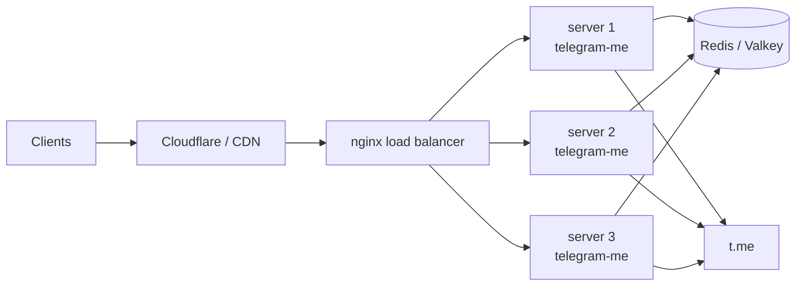
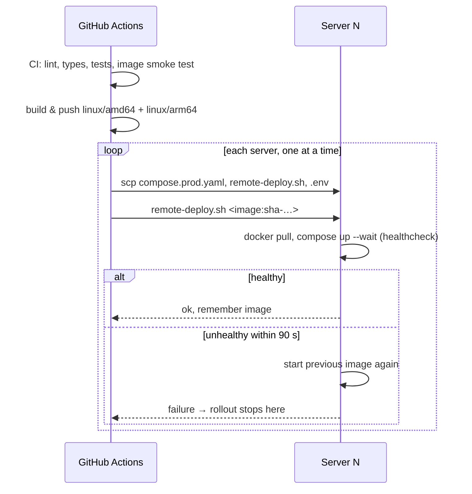

# Production

The reference production setup is several identical servers sharing one
Redis, deployed by GitHub Actions with rolling updates and automatic
rollback. Requests reach the servers either through a load balancer of your
own, or straight from Cloudflare (proxied DNS records, one per server), with
a Caddy container on each server terminating TLS (see
[Cloudflare without a load balancer](#cloudflare-without-a-load-balancer)).



## Server preparation

Run [`deploy/bootstrap-server.sh`](https://github.com/koval01/telegram-me/blob/main/deploy/bootstrap-server.sh)
once on each fresh Ubuntu server, as the user GitHub Actions logs in as:

```bash
ssh ubuntu@<server> 'bash -s' < deploy/bootstrap-server.sh
```

It is safe to run again. It:

- installs Docker Engine and the compose plugin from Docker's repository;
- adds the user to the `docker` group;
- adds 2 GiB of swap when there is none (`SWAP_MB=0` skips it). This helps
  small machines such as 1 GB cloud instances;
- opens port 443 in the host firewall of Oracle Cloud images, which reject
  everything but SSH. The cloud security list or security group still decides
  who may connect.

Behind a load balancer of your own, allow it to reach port `8000` and nothing
else from outside, for example with UFW:

```bash
sudo ufw default deny incoming
sudo ufw allow ssh
sudo ufw allow from 10.0.0.0/24 to any port 8000 proto tcp
sudo ufw enable
```

Nothing else needs to be installed: the workflow copies the compose file, the
deploy script and the `.env` on every deployment.

## How a deployment works



- Pushing to `main` runs CI, builds the image (`latest` and `sha-…` tags) and
  deploys `sha-…` to every server listed in `SERVERS_IPS`, one after another.
- [`deploy/remote-deploy.sh`](https://github.com/koval01/telegram-me/blob/main/deploy/remote-deploy.sh)
  waits until the new container is healthy. Otherwise it restarts the
  previously deployed image (recorded in `~/telegram-me/.deployed-image`) and
  fails, which stops the rollout — the remaining servers keep the old version.
- The first 2.0 deployment replaces the 1.x container (named `telegram-me`,
  started with `docker run`). If 2.0 does not become healthy, the 1.x container
  is started again from its image and `~/env.app`.
- Pushing a tag `v2.0.0` additionally publishes `2.0.0`, `2.0`, `2` tags and a
  GitHub release with the notes from `CHANGELOG.md`.

## Configuration

### Secrets

| Secret | Required | Purpose |
|---|---|---|
| `SERVERS_IPS` | yes | Server addresses separated by spaces, e.g. `203.0.113.10 203.0.113.11`. The workflow masks each address in its logs and names servers 1, 2, … |
| `SSH_KEY` | yes | Private key for `SSH_USER` |
| `SSH_KNOWN_HOSTS` | recommended | `ssh-keyscan` output for the servers; without it host keys are trusted on first use (with a warning) |
| `REDIS_URL` | yes | Shared Redis for all servers |
| `CF_BYPASS_KEY` | no | Sent as `x-bypass-key` by the public health check, for a Cloudflare WAF rule that skips bot protection for it |
| `POW_SECRET` | with `ENABLE_POW` | Signs proof-of-work challenges; at least 32 characters ([`POW_SECRET`](../configuration.md#pow_secret)) |
| `TLS_CERT`, `TLS_KEY` | with `PUBLIC_HOST` | Cloudflare Origin CA certificate and key (PEM) for Caddy; without them Caddy uses a self-signed certificate |
| `DOCKER_USERNAME`, `DOCKERHUB_TOKEN` | yes | Push to Docker Hub (`DOCKER_PASSWORD` is accepted instead of the token) |

### Variables

Repository variables override the production `.env` written on every
deployment:

| Variable | Default | Notes |
|---|---|---|
| `ENABLE_FEED` | `true` | Kept on in production for existing clients; the application default is `false` |
| `ENABLE_PREVIEWS` | `true` | |
| `ENABLE_RATE_LIMIT`, `RATE_LIMIT_RPM` | `false`, `120` | See [Rate limit and proof of work](../api/protection.md) |
| `RATE_LIMIT_BURST`, `RATE_LIMIT_SHARED` | `RATE_LIMIT_RPM`, `true` | |
| `ENABLE_POW`, `POW_DIFFICULTY` | `false`, `18` | `ENABLE_POW` needs the `POW_SECRET` secret; the deploy stops without it |
| `POW_CHALLENGE_TTL`, `POW_BIND_IP` | `300`, `true` | |
| `CACHE_MODE`, `PARSER_MODE` | `normal`, `full` | |
| `PUBLIC_HOST` | — | Public hostname, e.g. `api.example.com`. Set it to run Caddy on port 443 of every server (Cloudflare without a load balancer) |
| `FORWARDED_ALLOW_IPS` | `127.0.0.1` | Set to the load balancer address(es). With `PUBLIC_HOST`: `172.29.53.0/24`, the stack's own network (Caddy) |
| `DISABLE_DOCS` | `false` | |
| `DEPLOY_IMAGE` | `docker.io/koval01/telegram-me` | Repository to deploy from |
| `SSH_USER` | `ubuntu` | |
| `PUBLIC_HEALTHCHECK_URL` | — | Checked after the rollout, e.g. `https://api.example.com/healthz` |

Use the `production` environment in the repository settings to add required
reviewers or restrict which branches may deploy.

## Cloudflare without a load balancer

With proxied DNS records pointing at the servers themselves, Cloudflare
connects to port 443 of each one. Set the `PUBLIC_HOST` variable, and every
deployment then also runs the `proxy` service of `compose.prod.yaml`: Caddy
([`deploy/Caddyfile`](https://github.com/koval01/telegram-me/blob/main/deploy/Caddyfile)).

- Caddy terminates TLS and forwards to the API, which then listens on
  `127.0.0.1:8000` only.
- The client address comes from `CF-Connecting-IP`, trusted only from
  [Cloudflare's ranges](https://www.cloudflare.com/ips/). Caddy passes it on
  in `X-Forwarded-For`, so rate limiting and logs see real clients.
- **Certificate.** Create an Origin CA certificate in the Cloudflare dashboard
  (*SSL/TLS → Origin Server*) and store it as the `TLS_CERT` and `TLS_KEY`
  secrets. Then use SSL mode **Full (strict)**. Without them Caddy serves a
  self-signed certificate, which works with SSL mode **Full** only.
- Let only Cloudflare's ranges reach port 443 in the cloud firewall (security
  list or group), and nothing reach port 8000.

API clients are programs, not browsers. Cloudflare's bot protection (Bot
Fight Mode, the "I'm Under Attack" level, Managed Challenge rules) answers
them with a challenge page (`403`) instead of JSON, and that includes the
deployment's public health check. Keep it off when programs are meant to use
the API. When it stays on (a demo, say), add a WAF custom rule that skips it
for requests whose header matches a long random key, for example
`any(http.request.headers["x-bypass-key"][*] eq "<key>")`. Store the key as
the `CF_BYPASS_KEY` secret for the health check, and pass it to the smoke
test with `--header "x-bypass-key:$KEY"`.

Cloudflare picks one of the DNS records per connection. While one server
restarts during a rolling deployment, some requests to it can fail for a few
seconds.

## Rolling back

Run the **Deploy** workflow manually (*Actions → Deploy → Run workflow*) with
the tag to go back to, for example `sha-0123456789ab` (every build is kept in
the registry). The same rolling procedure is used.

On a single server you can also roll back by hand:

```bash
cd ~/telegram-me
APP_IMAGE=docker.io/koval01/telegram-me:sha-0123456789ab \
  docker compose -f compose.prod.yaml up -d --wait
```

## Standalone feed worker

To keep the feed refresher off the API processes, run the Deploy workflow with
**with_worker** checked: every server then starts the `worker` service and the
API runs with `FEED_REFRESH_MODE=worker`. Leader election in Redis guarantees a
single active refresher across all servers either way.

## Operations

```bash
cd ~/telegram-me
docker compose -f compose.prod.yaml ps
docker compose -f compose.prod.yaml logs -f --since 10m api
cat .deployed-image
```

Logs are JSON lines in production (`LOG_FORMAT=json`), rotated at 5 × 50 MB.
