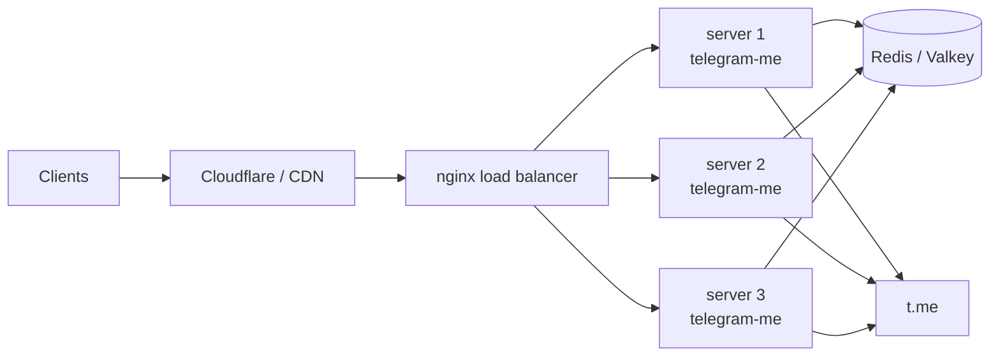
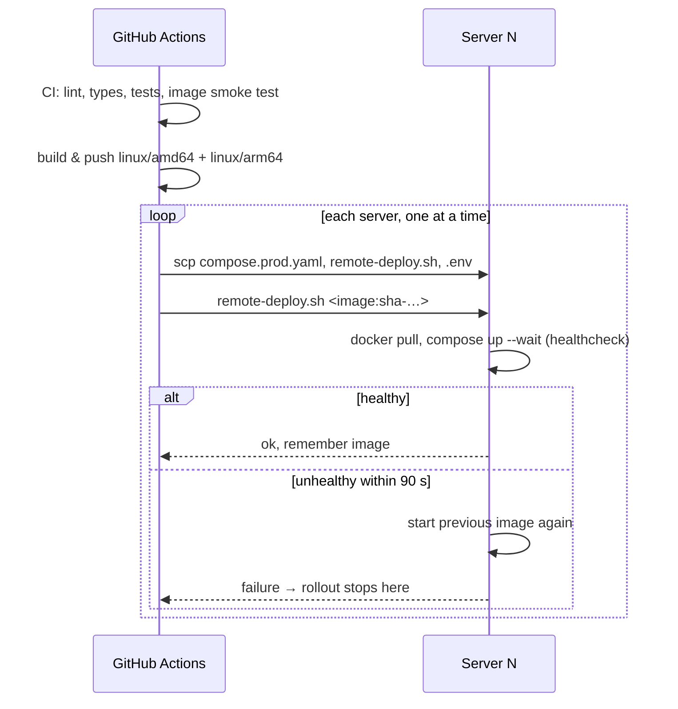

# Production

The reference production setup is several identical servers behind a load
balancer, sharing one Redis, deployed by GitHub Actions with rolling updates
and automatic rollback.



## Server preparation

On each server (Ubuntu or any Linux with Docker):

```bash
curl -fsSL https://get.docker.com | sudo sh
sudo usermod -aG docker ubuntu        # the user GitHub Actions logs in as
```

Allow the load balancer to reach port `8000` and nothing else from outside,
for example with UFW:

```bash
sudo ufw default deny incoming
sudo ufw allow ssh
sudo ufw allow from 10.0.0.0/24 to any port 8000 proto tcp
sudo ufw enable
```

Nothing else needs to be installed: the workflow copies the compose file, the
deploy script and the `.env` on every deployment.

## How a deployment works



- Pushing to `main` runs CI, builds the image (`latest` and `sha-…` tags) and
  deploys `sha-…` to every server listed in `SERVERS_IPS`, one after another.
- [`deploy/remote-deploy.sh`](https://github.com/koval01/telegram-me/blob/main/deploy/remote-deploy.sh)
  waits until the new container is healthy. Otherwise it restarts the
  previously deployed image (recorded in `~/telegram-me/.deployed-image`) and
  fails, which stops the rollout — the remaining servers keep the old version.
- The first 2.0 deployment replaces the 1.x container (named `telegram-me`,
  started with `docker run`). If 2.0 does not become healthy, the 1.x container
  is started again from its image and `~/env.app`.
- Pushing a tag `v2.0.0` additionally publishes `2.0.0`, `2.0`, `2` tags and a
  GitHub release with the notes from `CHANGELOG.md`.

## Configuration

### Secrets

| Secret | Required | Purpose |
|---|---|---|
| `SERVERS_IPS` | yes | Space-separated server addresses |
| `SSH_KEY` | yes | Private key for `SSH_USER` |
| `SSH_KNOWN_HOSTS` | recommended | `ssh-keyscan` output for the servers; without it host keys are trusted on first use (with a warning) |
| `REDIS_URL` | yes | Shared Redis for all servers |
| `DOCKER_USERNAME`, `DOCKERHUB_TOKEN` | yes | Push to Docker Hub (`DOCKER_PASSWORD` is accepted instead of the token) |

### Variables

Repository variables override the production `.env` written on every
deployment:

| Variable | Default | Notes |
|---|---|---|
| `ENABLE_FEED` | `true` | Kept on in production for existing clients; the application default is `false` |
| `ENABLE_PREVIEWS` | `true` | |
| `ENABLE_RATE_LIMIT`, `RATE_LIMIT_RPM` | `false`, `120` | |
| `CACHE_MODE`, `PARSER_MODE` | `normal`, `full` | |
| `FORWARDED_ALLOW_IPS` | `127.0.0.1` | Set to the load balancer address(es) |
| `DISABLE_DOCS` | `false` | |
| `DEPLOY_IMAGE` | `docker.io/koval01/telegram-me` | Repository to deploy from |
| `SSH_USER` | `ubuntu` | |
| `PUBLIC_HEALTHCHECK_URL` | — | Checked after the rollout, e.g. `https://api.example.com/healthz` |

Use the `production` environment in the repository settings to add required
reviewers or restrict which branches may deploy.

## Rolling back

Run the **Deploy** workflow manually (*Actions → Deploy → Run workflow*) with
the tag to go back to, for example `sha-0123456789ab` (every build is kept in
the registry). The same rolling procedure is used.

On a single server you can also roll back by hand:

```bash
cd ~/telegram-me
APP_IMAGE=docker.io/koval01/telegram-me:sha-0123456789ab \
  docker compose -f compose.prod.yaml up -d --wait
```

## Standalone feed worker

To keep the feed refresher off the API processes, run the Deploy workflow with
**with_worker** checked: every server then starts the `worker` service and the
API runs with `FEED_REFRESH_MODE=worker`. Leader election in Redis guarantees a
single active refresher across all servers either way.

## Operations

```bash
cd ~/telegram-me
docker compose -f compose.prod.yaml ps
docker compose -f compose.prod.yaml logs -f --since 10m api
cat .deployed-image
```

Logs are JSON lines in production (`LOG_FORMAT=json`), rotated at 5 × 50 MB.
