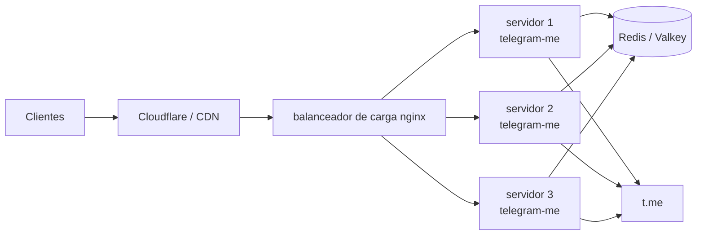
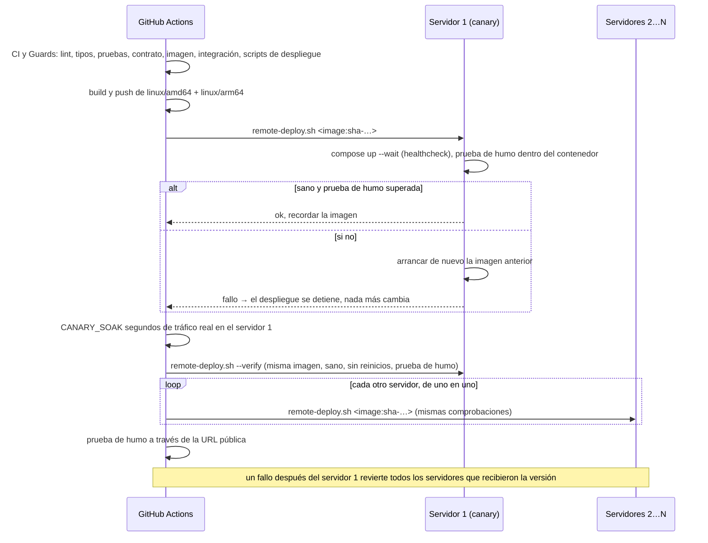

# Producción

La configuración de producción de referencia son varios servidores idénticos
que comparten un Redis, desplegados por GitHub Actions con actualizaciones
escalonadas y reversión automática. Las solicitudes llegan a los servidores a
través de un balanceador de carga propio o directamente desde Cloudflare
(registros DNS con proxy, uno por servidor), con un contenedor de Caddy en
cada servidor que termina TLS (consulta
[Cloudflare sin balanceador de carga](#cloudflare-without-a-load-balancer)).



## Preparación del servidor { #server-preparation }

Ejecuta
[`deploy/bootstrap-server.sh`](https://github.com/koval01/telegram-me/blob/main/deploy/bootstrap-server.sh)
una vez en cada servidor Ubuntu nuevo, con el usuario con el que inicia sesión
GitHub Actions:

```bash
ssh ubuntu@<server> 'bash -s' < deploy/bootstrap-server.sh
```

Se puede volver a ejecutar sin problemas. El script:

- instala Docker Engine y el plugin de compose desde el repositorio de Docker;
- añade el usuario al grupo `docker`;
- añade 2 GiB de swap cuando no hay ninguno (`SWAP_MB=0` lo omite). Esto ayuda
  a máquinas pequeñas como las instancias en la nube de 1 GB;
- abre el puerto 443 en el cortafuegos del host de las imágenes de Oracle
  Cloud, que rechazan todo salvo SSH. La lista de seguridad o el grupo de
  seguridad de la nube siguen decidiendo quién puede conectarse.

Detrás de un balanceador de carga propio, permite que este llegue al puerto
`8000` y nada más desde el exterior, por ejemplo con UFW:

```bash
sudo ufw default deny incoming
sudo ufw allow ssh
sudo ufw allow from 10.0.0.0/24 to any port 8000 proto tcp
sudo ufw enable
```

No hace falta instalar nada más: el workflow copia el archivo de compose, el
script de despliegue y el `.env` en cada despliegue.

## Cómo funciona un despliegue { #how-a-deployment-works }



- Un push a `main` ejecuta la CI y Guards, construye la imagen (etiquetas
  `latest` y `sha-…`) y despliega `sha-…` en todos los servidores listados en
  `SERVERS_IPS`, uno tras otro
  ([`deploy/rollout.sh`](https://github.com/koval01/telegram-me/blob/main/deploy/rollout.sh)).
- [`deploy/remote-deploy.sh`](https://github.com/koval01/telegram-me/blob/main/deploy/remote-deploy.sh)
  espera hasta que el nuevo contenedor está sano y luego ejecuta la prueba de
  humo (`scripts/smoke_matrix.py`: códigos de estado y contenido de cada
  endpoint, dentro del contenedor contra t.me real, con un reintento). El
  healthcheck por sí solo solo demuestra que el proceso responde a
  `/healthz`; la prueba de humo demuestra que sirve páginas con la
  configuración y el Redis de este servidor. Si cualquiera de los dos falla,
  reinicia la imagen desplegada anteriormente (registrada en
  `~/telegram-me/.deployed-image`) y falla.
- El servidor 1 es el canary: tras recibir la versión sirve tráfico real
  durante `CANARY_SOAK` segundos (60 por defecto) y se verifica de nuevo: debe
  seguir ejecutando la imagen, estar sano, no haberse reiniciado ni haber sido
  matado por memoria, y superar la prueba de humo. Solo entonces se despliegan
  los demás servidores.
- Por último, la prueba de humo se ejecuta a través de la URL pública
  (`PUBLIC_URL`, o `https://PUBLIC_HOST`), es decir, a través de Cloudflare y
  Caddy, con la cabecera `CF_BYPASS_KEY`.
- Si alguna de estas comprobaciones falla después de que un servidor haya
  recibido la versión, se revierten todos los servidores que la recibieron
  (`remote-deploy.sh --rollback`), de modo que la flota nunca queda dividida
  entre dos versiones.
- El primer despliegue de 2.0 sustituye el contenedor 1.x (llamado
  `telegram-me`, arrancado con `docker run`). Si 2.0 no llega a estar sano, el
  contenedor 1.x se arranca de nuevo a partir de su imagen y de `~/env.app`.
- Un push de una etiqueta `v2.0.0` publica además las etiquetas `2.0.0`, `2.0`
  y `2` y una release de GitHub con las notas de `CHANGELOG.md`.

## Configuración { #configuration }

### Secretos { #secrets }

| Secreto | Obligatorio | Propósito |
|---|---|---|
| `SERVERS_IPS` | sí | Direcciones de los servidores separadas por espacios, p. ej. `203.0.113.10 203.0.113.11`. El workflow enmascara cada dirección en sus logs y llama a los servidores 1, 2, … |
| `SSH_KEY` | sí | Clave privada para `SSH_USER` |
| `SSH_KNOWN_HOSTS` | recomendado | Salida de `ssh-keyscan` para los servidores; sin ella, las claves de host se aceptan en el primer uso (con una advertencia) |
| `REDIS_URL` | sí | Redis compartido por todos los servidores |
| `CF_BYPASS_KEY` | no | La prueba de humo y la comprobación de salud públicas lo envían como `x-bypass-key`, para una regla WAF de Cloudflare que las exime de la protección contra bots |
| `POW_SECRET` | con `ENABLE_POW` | Firma los desafíos de prueba de trabajo; al menos 32 caracteres ([`POW_SECRET`](../configuration.md#pow_secret)) |
| `TLS_CERT`, `TLS_KEY` | con `PUBLIC_HOST` | Certificado y clave de Cloudflare Origin CA (PEM) para Caddy; sin ellos Caddy usa un certificado autofirmado |
| `DOCKER_USERNAME`, `DOCKERHUB_TOKEN` | sí | Push a Docker Hub (se acepta `DOCKER_PASSWORD` en lugar del token) |

### Variables { #variables }

Las variables del repositorio sobrescriben el `.env` de producción que se
escribe en cada despliegue:

| Variable | Por defecto | Notas |
|---|---|---|
| `ENABLE_FEED` | `true` | Se mantiene activado en producción para los clientes existentes; el valor por defecto de la aplicación es `false` |
| `ENABLE_PREVIEWS` | `true` | |
| `ENABLE_RATE_LIMIT`, `RATE_LIMIT_RPM` | `false`, `120` | Consulta [Límite de peticiones y prueba de trabajo](../api/protection.md) |
| `RATE_LIMIT_BURST`, `RATE_LIMIT_SHARED` | `RATE_LIMIT_RPM`, `true` | |
| `ENABLE_POW`, `POW_DIFFICULTY` | `false`, `18` | `ENABLE_POW` necesita el secreto `POW_SECRET`; sin él, el despliegue se detiene |
| `POW_CHALLENGE_TTL`, `POW_BIND_IP` | `300`, `true` | |
| `CACHE_MODE`, `PARSER_MODE` | `normal`, `full` | |
| `PUBLIC_HOST` | — | Nombre de host público, p. ej. `api.example.com`. Defínelo para ejecutar Caddy en el puerto 443 de cada servidor (Cloudflare sin balanceador de carga) |
| `FORWARDED_ALLOW_IPS` | `127.0.0.1` | Defínelo con la(s) dirección(es) del balanceador de carga. Con `PUBLIC_HOST`: `172.29.53.0/24`, la red propia del stack (Caddy) |
| `DISABLE_DOCS` | `false` | |
| `DEPLOY_IMAGE` | `docker.io/koval01/telegram-me` | Repositorio desde el que se despliega |
| `SSH_USER` | `ubuntu` | |
| `PUBLIC_HEALTHCHECK_URL` | — | Se comprueba tras el despliegue, p. ej. `https://api.example.com/healthz` |
| `PUBLIC_URL` | `https://PUBLIC_HOST` | URL base de la prueba de humo pública tras el despliegue; sin ella ni `PUBLIC_HOST` la prueba se omite |
| `CANARY_SOAK` | `60` | Segundos que el servidor 1 sirve una versión nueva antes de verificarse de nuevo y de que le sigan los demás servidores; `0` omite la comprobación canary |

Usa el entorno `production` en la configuración del repositorio para añadir
revisores obligatorios o restringir qué ramas pueden desplegar.

## Cloudflare sin balanceador de carga { #cloudflare-without-a-load-balancer }

Con registros DNS con proxy que apuntan a los propios servidores, Cloudflare se
conecta al puerto 443 de cada uno. Define la variable `PUBLIC_HOST` y cada
despliegue ejecutará también el servicio `proxy` de `compose.prod.yaml`: Caddy
([`deploy/Caddyfile`](https://github.com/koval01/telegram-me/blob/main/deploy/Caddyfile)).

- Caddy termina TLS y reenvía a la API, que entonces escucha solo en
  `127.0.0.1:8000`.
- La dirección del cliente se toma de `CF-Connecting-IP`, en la que solo se
  confía si procede de los
  [rangos de Cloudflare](https://www.cloudflare.com/ips/). Caddy la transmite
  en `X-Forwarded-For`, de modo que el límite de solicitudes y los logs ven a
  los clientes reales.
- **Certificado.** Crea un certificado Origin CA en el panel de Cloudflare
  (*SSL/TLS → Origin Server*) y guárdalo en los secretos `TLS_CERT` y
  `TLS_KEY`. Después usa el modo SSL **Full (strict)**. Sin ellos, Caddy sirve
  un certificado autofirmado, que solo funciona con el modo SSL **Full**.
- Deja que solo los rangos de Cloudflare lleguen al puerto 443 en el
  cortafuegos de la nube (lista o grupo de seguridad), y que nada llegue al
  puerto 8000.

Los clientes de la API son programas, no navegadores. La protección de
Cloudflare contra bots (Bot Fight Mode, el nivel «I'm Under Attack», las reglas
Managed Challenge) les responde con una página de verificación (`403`) en lugar
de JSON, y eso incluye la comprobación de salud pública del despliegue.
Desactívala si la API está pensada para programas. Si se queda activada (por
ejemplo, en una demo), añade una regla WAF personalizada que la omita para las
peticiones cuya cabecera coincida con una clave aleatoria larga, por ejemplo
`any(http.request.headers["x-bypass-key"][*] eq "<key>")`. Guarda la clave en
el secreto `CF_BYPASS_KEY` para la prueba de humo y la comprobación de salud
públicas del despliegue, y pásala a mano al smoke test con
`--header "x-bypass-key:$KEY"`.

Cloudflare elige uno de los registros DNS por conexión. Mientras un servidor se
reinicia durante un despliegue escalonado, algunas solicitudes dirigidas a él
pueden fallar durante unos segundos.

## Revertir { #rolling-back }

Ejecuta manualmente el workflow **Deploy** (*Actions → Deploy → Run workflow*)
con la etiqueta a la que quieras volver, por ejemplo `sha-0123456789ab` (todas
las builds se conservan en el registro). Se usa el mismo procedimiento
escalonado, con las mismas comprobaciones; desmarca **smoke** solo mientras
el propio t.me esté caído, cuando ninguna versión puede superarla.

En un único servidor también puedes revertir a mano, a la imagen desplegada
antes de la última o a cualquier otra:

```bash
bash ~/telegram-me/remote-deploy.sh --rollback
cd ~/telegram-me
APP_IMAGE=docker.io/koval01/telegram-me:sha-0123456789ab \
  docker compose -f compose.prod.yaml up -d --wait
```

## Worker del feed independiente { #standalone-feed-worker }

Para mantener el actualizador del feed fuera de los procesos de la API, ejecuta
el workflow Deploy con **with_worker** marcado: cada servidor arranca entonces
el servicio `worker` y la API se ejecuta con `FEED_REFRESH_MODE=worker`. En
cualquier caso, la elección de líder en Redis garantiza un único actualizador
activo entre todos los servidores.

## Operación { #operations }

```bash
cd ~/telegram-me
docker compose -f compose.prod.yaml ps
docker compose -f compose.prod.yaml logs -f --since 10m api
cat .deployed-image
```

En producción los logs son líneas JSON (`LOG_FORMAT=json`), rotadas en
5 × 50 MB.
