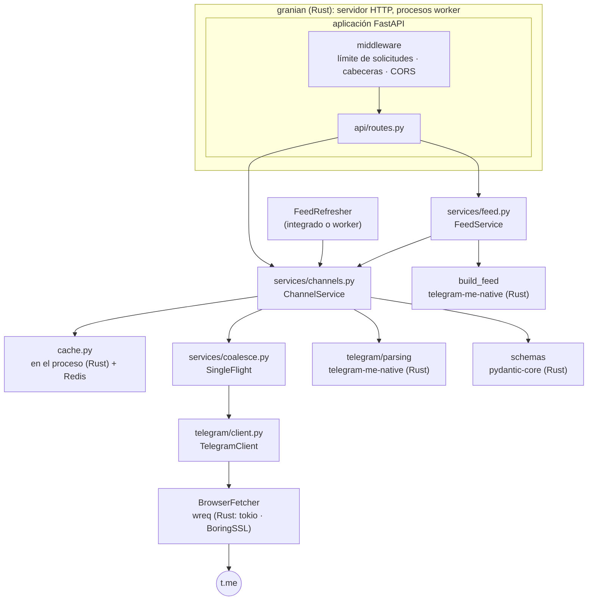

# Arquitectura

TelegramMe es una capa fina y tipada sobre las vistas previas web públicas de
t.me. Python contiene la lógica de negocio; las partes costosas (E/S de red,
TLS, HTTP/2, análisis de HTML, JSON, el servidor HTTP) se ejecutan en código
nativo.

## Capas { #layers }

| Paquete | Responsabilidad |
|---|---|
| `api/` | Solo asuntos HTTP: rutas, validación de parámetros, feature flags, correspondencia error → estado, middleware ASGI puro |
| `services/` | Lógica de negocio: descargar, guardar en caché y validar páginas, el feed, la puntuación, la popularidad, la agrupación de solicitudes |
| `telegram/` | Todo lo específico de t.me: el cliente HTTP con sus reglas de reintento y concurrencia, los parsers de HTML, los tipos de error |
| `schemas/` | Modelos públicos de respuesta y de solicitud |
| `cache.py` | Niveles dentro del proceso y Redis con antigüedad de las entradas, circuit breaker |
| `container.py` | Crea y cierra los objetos de larga duración; el único lugar que sabe cómo está conectado todo |
| `app.py`, `server.py` | Fábrica de la aplicación con lifespan; puntos de entrada de los procesos |

Las dependencias solo apuntan hacia abajo: `api` → `services` → `telegram`,
`cache`. Nada por debajo de `api` importa FastAPI.

## Ciclo de vida de una solicitud { #request-lifecycle }

Tomando `GET /v1/body/durov` como ejemplo:

1. **granian** acepta la conexión y entrega la solicitud a un worker.
2. **Middleware**: límite de solicitudes (si está activado), luego cabeceras de
   respuesta (`X-App-Node`, `X-Process-Time`, `Cache-Control` para
   Cloudflare) y luego CORS.
3. **FastAPI** valida `channel` contra el patrón de nombres de usuario
   (→ `422`).
4. **`ChannelService.body_json`** busca la respuesta *ya renderizada* en la
   caché. Un acierto se devuelve como bytes: sin análisis ni validación.
5. En caso de fallo, **SingleFlight** se asegura de que solo una corrutina
   descargue `t.me/s/durov`; las solicitudes concurrentes esperan a la misma
   tarea. Con Redis, esa corrutina toma una concesión breve para que, de todos
   los servidores, solo un proceso la descargue; los demás recogen su
   resultado de la caché (consulta [Caché](caching.md#request-coalescing)).
6. **`TelegramClient`** toma un hueco de la puerta hacia el origen del proceso
   (justa entre canales y solicitudes de feed, `503` cuando su cola está
   llena) y pide la página a **`BrowserFetcher`**; wreq realiza la solicitud
   sobre una conexión HTTP/2 del pool en Rust, fuera del GIL, con el handshake
   TLS y las cabeceras de un navegador ([Cliente HTTP](http-client.md)), y
   devuelve el cuerpo decodificado. Una conexión caída se reintenta una vez.
7. En uno de los dos hilos de análisis, **`parse_channel_page`** entrega el
   HTML al parser de Rust (con el GIL liberado), que construye el árbol una
   sola vez con html5ever y extrae el perfil del canal, la paginación y cada
   publicación; una publicación que falla se omite y se registra en el log.
8. Todavía en ese hilo, la página analizada se valida contra `ChannelBody` (las
   publicaciones que no validan se descartan) y pydantic-core la serializa; de
   vuelta en el event loop se guarda en caché (para `/v1/post` y el feed) junto
   con la respuesta renderizada.
9. La ruta devuelve directamente los bytes JSON, sin pasar por la validación de
   respuestas propia de FastAPI.

## Lifespan { #lifespan }

`create_app()` construye la app de FastAPI; su lifespan abre un
[`Container`](https://github.com/koval01/telegram-me/blob/main/src/telegram_me/container.py)
(caché, cliente HTTP, servicios) y, si el feed está activado en modo
`embedded`, arranca la tarea del actualizador. Al apagarse, todo se cierra en
orden inverso: actualizador, cliente HTTP, caché.

## Modelo de procesos { #process-model }

`telegram-me serve` arranca granian con `WEB_CONCURRENCY` procesos worker. Cada
worker tiene su propio bucle de eventos (uvloop), su cliente HTTP y su caché
dentro del proceso (delante de Redis cuando está definido). granian reinicia los workers que fallan, puede
reciclar workers según su memoria y reenvía `SIGTERM` para un apagado
ordenado.

`telegram-me worker` ejecuta solo el actualizador del feed, para los
despliegues que mantienen el trabajo en segundo plano fuera de los procesos de
la API.

## Componentes nativos { #native-components }

| Tarea | Biblioteca | Implementado en |
|---|---|---|
| Servidor HTTP, supervisión de workers | granian | Rust |
| Bucle de eventos | uvloop | C (libuv) |
| HTTP/2 saliente, TLS, pool de conexiones, descompresión | wreq (`telegram-me-native`); pyreqwest como alternativa | Rust (tokio, BoringSSL) |
| Análisis y extracción de HTML | `telegram-me-native` (html5ever, selectors, regex) | Rust |
| Validación, JSON (respuestas y caché) | pydantic-core | Rust |
| Protocolo de Redis | hiredis | C |
| Montaje del feed: señales, clasificación, duplicados, temas, respuesta | `telegram-me-native` (este proyecto) | Rust (PyO3) |
| Caché dentro del proceso | `telegram-me-native` (moka, libzstd) | Rust (PyO3), C |
| Planificación de solicitudes: vuelos, puerta justa hacia el origen, puntos de renovación | `telegram-me-native` (este proyecto) | Rust (PyO3) |

El código nativo escrito para este proyecto está en el crate de Rust
[`rust/telegram-me-native`](https://github.com/koval01/telegram-me/tree/main/rust/telegram-me-native),
compilado con maturin como miembro del workspace de uv. Python sigue siendo la
capa de orquestación: descarga, caché, enrutamiento y unión de los resultados.
Lo que aún queda en Python en la ruta crítica, y el orden en que pasa a Rust,
está en la [Hoja de ruta hacia Rust](rust-roadmap.md).

El efecto medido está en la página de [Rendimiento](performance.md).
