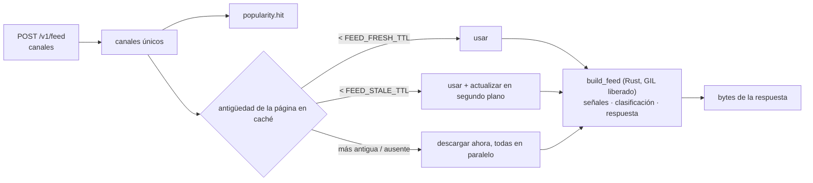

# Funcionamiento interno del feed

## Construcción de un feed { #building-a-feed }



1. Los canales se deduplican (manteniendo el orden) y se cuentan en la
   clasificación de popularidad.
2. Todas las páginas se resuelven de forma concurrente con las reglas
   anteriores. Cada página se usa tal como la guarda la caché de páginas, en
   bytes; una página descargada en ese momento llega junto con su codificación
   para la caché, de modo que en Python no se decodifica ni se codifica nada.
3. `telegram_me_native.build_feed()` (Rust,
   [`rust/telegram-me-native/src/feed.rs`](https://github.com/koval01/telegram-me/blob/main/rust/telegram-me-native/src/feed.rs))
   se ejecuta en un hilo de trabajo con el GIL liberado y hace el resto en una
   sola llamada:
    - lee cada página en una sola pasada, conservando cada publicación como el
      texto JSON con el que se guardó en caché, y descarta las publicaciones ya
      vistas con el mismo nombre de usuario;
    - extrae las señales de clasificación del footer y del content de cada
      publicación: contador de visualizaciones analizado (`1.2K`, `15 400`),
      suscriptores del canal, totales de reacciones positivas y negativas,
      número de elementos multimedia, texto plano, momento de publicación,
      marca de edición;
    - las clasifica ([`rank.rs`](https://github.com/koval01/telegram-me/blob/main/rust/telegram-me-native/src/rank.rs), más abajo);
    - escribe la respuesta: cada publicación con su `channel`, `_score` y,
      cuando corresponde, `_duplicates` y `_topic`.

    Una página que no es JSON válido (una entrada de caché dañada) se omite y
    se registra en el log. El campo `feed` de GraphQL decodifica los mismos
    bytes.

## Clasificación { #ranking }

Todo lo que sigue ocurre en Rust.

### Texto { #text }

Los textos se dividen en palabras alfanuméricas en minúsculas; se descartan las
URL, las menciones, los números, las palabras cortas y las palabras vacías en
ruso, ucraniano e inglés. Las palabras se reducen a su raíz quitando una
terminación flexiva cirílica común y conservando los cinco primeros caracteres
(«ракеты», «ракетой» → «ракет»), lo que hace coincidir las formas flexionadas
sin ningún modelo de lenguaje.

### Calidad { #quality }

| Señal | Cómo |
|---|---|
| **Interacción** (peso 0.45) | Las visualizaciones se proyectan a su valor final a partir de la antigüedad de la publicación (`views / (1 − e^(−age/24h))`) y se comparan, en escala logarítmica, con las demás publicaciones del canal en el lote: un z-score robusto que usa la mediana y la desviación absoluta mediana, comprimido con una sigmoide. Una publicación a la que le va inusualmente bien *para su canal* puntúa alto sea cual sea el tamaño del canal. Los canales con menos de tres publicaciones en el lote se comparan con todas las publicaciones según las visualizaciones por suscriptor. |
| **Reacciones** (0.20) | Reacciones positivas netas por visualización (las Telegram Stars cuentan como positivas), con saturación en el 2 %. |
| **Contenido** (0.15) | Multimedia (`photos + 2·videos + gifs + 2·polls`, en escala logarítmica) y longitud del texto. |
| **Audiencia** (0.10) | Logaritmo de los suscriptores respecto al canal más grande del lote. |
| **Sentimiento** (0.10) | Uno menos la proporción de reacciones negativas. |
| **Editada** (+0.02) | Pequeña bonificación. |

### Actualidad { #freshness }

```text
freshness = 0.5 ^ (age_hours / FEED_HALF_LIFE_HOURS)          (default 24 h)
score     = 10 · quality · (0.1 + 0.9 · freshness)             ∈ [0, 10]
```

### Duplicados { #duplicates }

La misma noticia la publican a menudo varios canales, a veces con un titular o
una firma añadidos. Cada texto de al menos diez palabras recibe un SimHash de
64 bits de sus shingles de tres palabras y el conjunto de esos shingles. Dos
publicaciones son duplicadas cuando sus valores SimHash difieren como mucho en
20 bits (un prefiltro barato) **y** al menos el 70 % de los shingles del texto
más corto aparecen en el otro (contención). Los duplicados se agrupan de forma
transitiva (union-find); la publicación con mejor puntuación de cada grupo
permanece en el feed y enumera las demás en `_duplicates`. Se desactiva con
[`FEED_COLLAPSE_DUPLICATES=false`](../configuration.md#feed_collapse_duplicates).

### Diversidad { #diversity }

Las publicaciones se colocan de forma voraz. La puntuación ajustada de una
candidata es

```text
score · (1 − d · max cosine similarity to the last 10 placed posts)
      · (1 − d/2) ^ (posts of the same channel among the last 5 placed)
```

con `d` = [`FEED_DIVERSITY`](../configuration.md#feed_diversity) (por defecto
0.5; 0 da el orden simple por puntuación). La similitud es el coseno de
vectores TF-IDF. Como las penalizaciones nunca suben una puntuación, las
candidatas se recorren en orden de puntuación base y el recorrido se detiene en
cuanto ninguna puntuación base restante puede superar a la mejor ajustada, así
que el resultado es exacto sin comparar todos los pares en cada paso.

La actualidad sigue dominando: un canal que publicó hace unas horas llenará
casi toda la parte superior de un feed cuyos otros canales publicaron hace
semanas. La diversidad reparte publicaciones de valor comparable; no promociona
las antiguas.

### Temas { #topics }

Telegram no expone las categorías de los canales, así que los temas se infieren
de los textos: vectores TF-IDF sobre el lote (IDF suavizado), agrupados de
forma voraz en el orden del feed; una publicación se une al tema más parecido
cuando la similitud del coseno con su centroide es de al menos 0.3 y, si no,
inicia uno nuevo. Los temas con al menos dos publicaciones se indican en sus
publicaciones como `_topic: {"id": …, "keywords": […]}`; las palabras clave
son los términos de mayor peso del centroide, en su forma escrita más
frecuente.

### Rendimiento { #performance }

La tokenización y la búsqueda de duplicados se ejecutan en paralelo en todos
los núcleos (rayon); las tablas hash usan FxHash. Medido con
`cargo run --release --example bench` (Apple Silicon, textos de 30 palabras):

| Publicaciones | Tiempo de clasificación |
|---|---|
| 120 (un feed de 6 canales) | ~1 ms |
| 500 | ~4 ms |
| 2 000 (100 canales) | 17–24 ms |

La clasificación se ejecuta en un hilo de trabajo con el GIL liberado, así que
mientras tanto el bucle de eventos sigue atendiendo otras solicitudes.

## La popularidad y el actualizador { #popularity-and-the-refresher }

Cada solicitud del feed suma 1 a la puntuación de cada canal que contiene. Las
puntuaciones decaen exponencialmente con `FEED_POPULARITY_HALF_LIFE` (1 hora):
cada minuto, el actualizador multiplica todas las puntuaciones por
`0.5^(elapsed / half-life)` y olvida los canales por debajo de 0.05. Con Redis,
la clasificación es un conjunto ordenado compartido por todas las instancias
(`ZINCRBY`, `ZUNIONSTORE … WEIGHTS`).

Cada 5 segundos, el actualizador:

1. toma o renueva el liderazgo (`SET … NX PX 30000` con un token aleatorio,
   renovado por un script Lua que comprueba el token); solo el líder continúa;
2. lee los `FEED_REFRESH_TOP` canales más populares;
3. actualiza cada canal cuya última actualización sea anterior a

    ```text
    interval(score) = clamp(FEED_REFRESH_MAX_INTERVAL / (1 + score),
                            FEED_REFRESH_MIN_INTERVAL, FEED_REFRESH_MAX_INTERVAL)
    ```

    Así, un canal pedido ~20 veces por vida media se actualiza cada 30 s, y
    un canal pedido una sola vez, cada 10 minutos.

El liderazgo cambia automáticamente cuando el líder se detiene (libera el
bloqueo) o muere (el bloqueo caduca en 30 s). Sin Redis, cada proceso es su
propio líder para su propia caché en memoria.

Las páginas actualizadas van a la caché de páginas compartida, así que la
siguiente solicitud del feed, en cualquier servidor, las encuentra al día.
