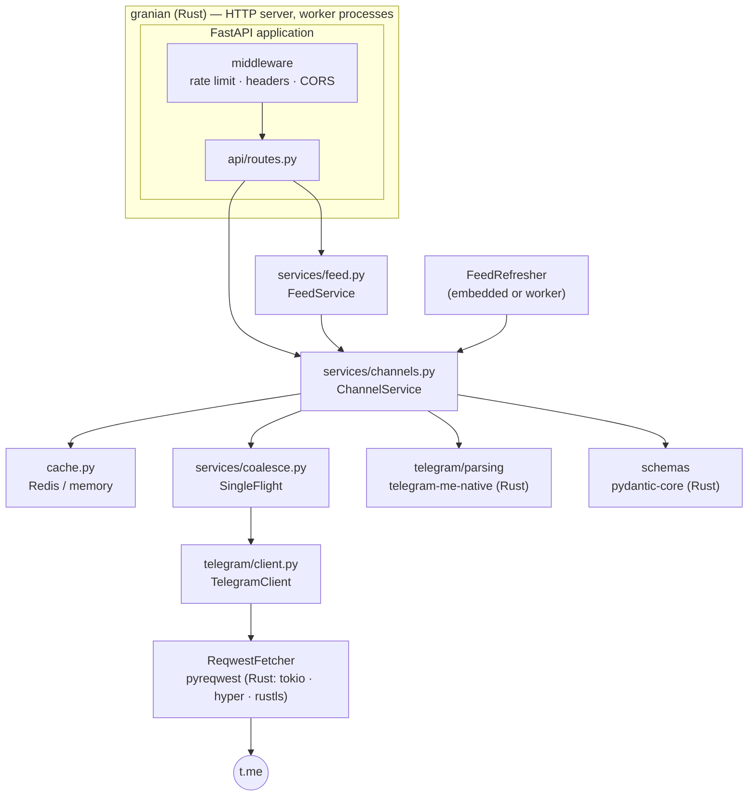

# Architecture

TelegramMe is a thin, typed layer over t.me's public web previews. Python
holds the business logic; the expensive parts — network I/O, TLS, HTTP/2,
HTML parsing, JSON, the HTTP server — run in native code.

## Layers

| Package | Responsibility |
|---|---|
| `api/` | HTTP concerns only: routes, parameter validation, feature flags, error → status mapping, pure-ASGI middleware |
| `services/` | Business logic: fetching, caching and validating pages, the feed, scoring, popularity, request coalescing |
| `telegram/` | Everything t.me-specific: the HTTP client with its retry and concurrency rules, the HTML parsers, error types |
| `schemas/` | Public response and request models |
| `cache.py` | Cache backends with entry age, circuit breaker |
| `container.py` | Creates and closes long-lived objects; the only place that knows how things are wired |
| `app.py`, `server.py` | Application factory with lifespan; process entry points |

Dependencies point downwards only: `api` → `services` → `telegram`, `cache`.
Nothing below `api` imports FastAPI.

## Request lifecycle

Taking `GET /v1/body/durov` as an example:

1. **granian** accepts the connection and hands the request to a worker.
2. **Middleware**: rate limiting (if enabled), then response headers
   (`X-App-Node`, `X-Process-Time`, Cloudflare `Cache-Control`), then CORS.
3. **FastAPI** validates `channel` against the username pattern (→ `422`).
4. **`ChannelService.body_json`** looks for the *rendered* response in the
   cache. A hit is returned as bytes — no parsing, no validation.
5. On a miss, **SingleFlight** makes sure only one coroutine fetches
   `t.me/s/durov`; concurrent requests await the same task.
6. **`TelegramClient`** takes a slot of the per-process concurrency semaphore
   and asks **`ReqwestFetcher`** for the page; pyreqwest performs the request on
   a pooled HTTP/2 connection in Rust, outside the GIL, and returns the decoded
   body. A dropped connection is retried once.
7. On one of two parsing threads, **`parse_channel_page`** hands the HTML to
   the Rust parser (GIL released), which builds the tree once with html5ever
   and extracts the channel profile, pagination and every post; a post that
   fails is skipped and logged.
8. Still on that thread, the parsed page is validated against `ChannelBody`
   (posts that do not validate are dropped) and serialized by pydantic-core;
   back on the event loop it is cached (for `/v1/post` and the feed) together
   with the rendered response.
9. The route returns the JSON bytes directly, bypassing FastAPI's own
   response validation.

## Lifespan

`create_app()` builds the FastAPI app; its lifespan opens a
[`Container`](https://github.com/koval01/telegram-me/blob/main/src/telegram_me/container.py)
(cache, HTTP client, services) and, if the feed is enabled in `embedded`
mode, starts the refresher task. On shutdown everything is closed in reverse
order: refresher, HTTP client, cache.

## Process model

`telegram-me serve` starts granian with `WEB_CONCURRENCY` worker processes.
Each worker has its own event loop (uvloop), HTTP client and — without Redis —
its own memory cache. granian restarts crashed workers, can recycle workers by
memory, and forwards `SIGTERM` for a graceful shutdown.

`telegram-me worker` runs only the feed refresher, for deployments that keep
background work off the API processes.

## Native components

| Concern | Library | Implemented in |
|---|---|---|
| HTTP server, worker supervision | granian | Rust |
| Event loop | uvloop | C (libuv) |
| Outgoing HTTP/2, TLS, pooling, decompression | pyreqwest | Rust (tokio, hyper, rustls) |
| HTML parsing and extraction | `telegram-me-native` (html5ever, selectors, regex) | Rust |
| Validation, JSON (responses and cache) | pydantic-core | Rust |
| Redis protocol | hiredis | C |
| Feed ranking, duplicates, topics | `telegram-me-native` (this project) | Rust (PyO3) |

Native code written for this project lives in the Rust crate
[`rust/telegram-me-native`](https://github.com/koval01/telegram-me/tree/main/rust/telegram-me-native),
built with maturin as a uv workspace member. Python stays the orchestration
layer: fetching, caching, routing and gluing results together.

The measured effect is on the [Performance](performance.md) page.
