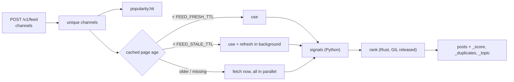

# Feed internals

## Building a feed



1. Channels are de-duplicated (order kept) and counted in the popularity
   ranking.
2. All pages are resolved concurrently with the rules above.
3. Python turns every post into a `Candidate`: parsed view counter, channel
   subscribers, positive and negative reaction totals, media counts, plain
   text, publication time, edited flag
   ([`services/feed_signals.py`](https://github.com/koval01/telegram-me/blob/main/src/telegram_me/services/feed_signals.py)).
4. `telegram_me_native.rank()` — Rust,
   [`rust/telegram-me-native/src/rank.rs`](https://github.com/koval01/telegram-me/blob/main/rust/telegram-me-native/src/rank.rs) —
   runs on a worker thread with the GIL released and returns the posts in
   feed order with scores, collapsed duplicates and topics.

## Ranking

Everything below happens in Rust.

### Text

Texts are tokenised into lower-cased alphanumeric words; URLs, mentions,
numbers, short words and Russian/Ukrainian/English stop words are dropped.
Words are stemmed by removing a common Cyrillic inflection ending and keeping
the first five characters ("ракеты", "ракетой" → "ракет"), which matches
inflected forms without any language model.

### Quality

| Signal | How |
|---|---|
| **Engagement** (weight 0.45) | Views are projected to their eventual value from the post's age (`views / (1 − e^(−age/24h))`) and compared, in log scale, with the channel's other posts in the batch: a robust z-score using the median and the median absolute deviation, squashed with a sigmoid. A post that does unusually well *for its channel* scores high whatever the channel's size. Channels with fewer than three posts in the batch are compared with all posts on views per subscriber instead. |
| **Reactions** (0.20) | Net positive reactions per view (Telegram Stars count as positive), saturating at 2 %. |
| **Content** (0.15) | Media (`photos + 2·videos + gifs + 2·polls`, log-scaled) and text length. |
| **Audience** (0.10) | Log of subscribers relative to the largest channel in the batch. |
| **Sentiment** (0.10) | One minus the share of negative reactions. |
| **Edited** (+0.02) | Small bonus. |

### Freshness

```text
freshness = 0.5 ^ (age_hours / FEED_HALF_LIFE_HOURS)          (default 24 h)
score     = 10 · quality · (0.1 + 0.9 · freshness)             ∈ [0, 10]
```

### Duplicates

The same story is often posted by several channels, sometimes with an added
headline or signature. Every text with at least ten words gets a 64-bit
SimHash of its three-word shingles and the set of those shingles. Two posts
are duplicates when their SimHash values differ in at most 20 bits (a cheap
pre-filter) **and** at least 70 % of the shorter text's shingles occur in the
other (containment). Duplicates are grouped transitively (union-find); the
best-scoring post of each group stays in the feed and lists the others in
`_duplicates`. Disable with
[`FEED_COLLAPSE_DUPLICATES=false`](../configuration.md#feed_collapse_duplicates).

### Diversity

Posts are placed greedily. The adjusted score of a candidate is

```text
score · (1 − d · max cosine similarity to the last 10 placed posts)
      · (1 − d/2) ^ (posts of the same channel among the last 5 placed)
```

with `d` = [`FEED_DIVERSITY`](../configuration.md#feed_diversity) (default
0.5; 0 gives plain score order). Similarity is the cosine of TF-IDF vectors.
Because penalties never raise a score, candidates are visited in base-score
order and the scan stops as soon as no remaining base score can beat the best
adjusted one, so the result is exact without comparing every pair at every
step.

Freshness still dominates: a channel that posted hours ago will fill most of
the top of a feed whose other channels posted weeks ago — diversity spreads
posts of comparable value, it does not promote stale ones.

### Topics

Telegram does not expose channel categories, so subjects are inferred from the
texts: TF-IDF vectors over the batch (smoothed IDF), clustered greedily in
feed order — a post joins the most similar topic when the cosine similarity
to its centroid is at least 0.3, otherwise it starts a new one. Topics with at
least two posts are reported on their posts as
`_topic: {"id": …, "keywords": […]}`; keywords are the heaviest centroid terms
in their most frequent written form.

### Performance

Tokenisation and the duplicate search run in parallel on all cores (rayon);
hash tables use FxHash. Measured with
`cargo run --release --example bench` (Apple Silicon, 30-word texts):

| Posts | Ranking time |
|---|---|
| 120 (a 6-channel feed) | ~1 ms |
| 500 | ~4 ms |
| 2 000 (100 channels) | 17–24 ms |

The ranking runs on a worker thread with the GIL released, so the event loop
keeps serving other requests meanwhile.

## Popularity and the refresher

Each feed request adds 1 to the score of every channel it contains. Scores
decay exponentially with `FEED_POPULARITY_HALF_LIFE` (1 hour): every minute
the refresher multiplies all scores by `0.5^(elapsed / half-life)` and forgets
channels below 0.05. With Redis the ranking is a sorted set shared by all
instances (`ZINCRBY`, `ZUNIONSTORE … WEIGHTS`).

Every 5 seconds the refresher:

1. takes or renews leadership (`SET … NX PX 30000` with a random token, renewed
   by a Lua script that checks the token) — only the leader continues;
2. reads the `FEED_REFRESH_TOP` most popular channels;
3. refreshes each channel whose last refresh is older than

    ```text
    interval(score) = clamp(FEED_REFRESH_MAX_INTERVAL / (1 + score),
                            FEED_REFRESH_MIN_INTERVAL, FEED_REFRESH_MAX_INTERVAL)
    ```

    — a channel requested ~20 times per half-life is refreshed every 30 s, a
    channel requested once every 10 minutes.

Leadership moves automatically when the leader stops (it releases the lock) or
dies (the lock expires within 30 s). Without Redis every process is its own
leader for its own memory cache.

Refreshed pages land in the shared page cache, so the next feed request — on
any server — finds them fresh.
