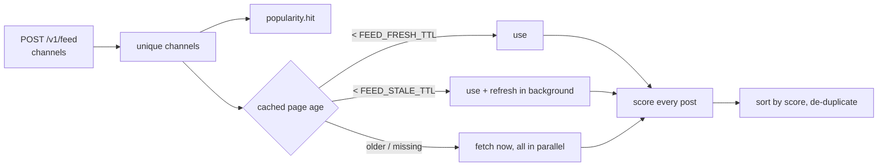

# Feed internals

## Building a feed



1. Channels are de-duplicated (order kept) and counted in the popularity
   ranking.
2. All pages are resolved concurrently with the rules above. Fetches go
   through the same coalescing and semaphore as every other request.
3. Each post is scored, annotated with `channel` and `_score`, and the list is
   sorted (stable) by score, highest first; `(channel, id)` duplicates are
   dropped.

## Scoring

Implemented in
[`services/scoring.py`](https://github.com/koval01/telegram-me/blob/main/src/telegram_me/services/scoring.py).
Counters are parsed from Telegram's compact notation (`1.2K` → 1200,
`3.5M` → 3 500 000). `S` = channel subscribers (at least 1).

**Engagement**

```text
reactions = Σ positive − Σ negative        (👍 ❤ ❤️ 😂 🔥 💯 👏 🎉 🥰  vs  👎 😡 😢 🤬 🤡)
engagement = ( min(views/S, 10) + min(reactions/S, 1) + min(comments/S, 0.5) ) / 3
```

Comments are currently always 0: t.me's embed pages no longer expose a
comment counter, and fetching one page per post made the endpoint 20× more
expensive for nothing (1.x did exactly that).

**Content**

```text
media   = 0.3·min(photos,10) + 0.5·min(videos,10) + 0.2·min(gifs,10) + 0.3·min(polls,10)
text    = 0.1 · min(len(text) / 500, 2)
content = min(media + text, 3)
```

**Freshness** (`h` = hours since publication)

```text
h ≤ 24        → 1 − 0.2 · h/24
24 < h ≤ 168  → 0.8 · e^(−0.8 · (h/24 − 1))
h > 168       → max(0.001, 0.1 · e^(−2 · (h/168 − 1)))
```

**Score**

```text
score = min( (0.4·engagement + 0.2·content + 0.02·edited) · (freshness + 0.1), 10 )
```

## Popularity and the refresher

Each feed request adds 1 to the score of every channel it contains. Scores
decay exponentially with `FEED_POPULARITY_HALF_LIFE` (1 hour): every minute
the refresher multiplies all scores by `0.5^(elapsed / half-life)` and forgets
channels below 0.05. With Redis the ranking is a sorted set shared by all
instances (`ZINCRBY`, `ZUNIONSTORE … WEIGHTS`).

Every 5 seconds the refresher:

1. takes or renews leadership (`SET … NX PX 30000` with a random token, renewed
   by a Lua script that checks the token) — only the leader continues;
2. reads the `FEED_REFRESH_TOP` most popular channels;
3. refreshes each channel whose last refresh is older than

    ```text
    interval(score) = clamp(FEED_REFRESH_MAX_INTERVAL / (1 + score),
                            FEED_REFRESH_MIN_INTERVAL, FEED_REFRESH_MAX_INTERVAL)
    ```

    — a channel requested ~20 times per half-life is refreshed every 30 s, a
    channel requested once every 10 minutes.

Leadership moves automatically when the leader stops (it releases the lock) or
dies (the lock expires within 30 s). Without Redis every process is its own
leader for its own memory cache.

Refreshed pages land in the shared page cache, so the next feed request — on
any server — finds them fresh.
