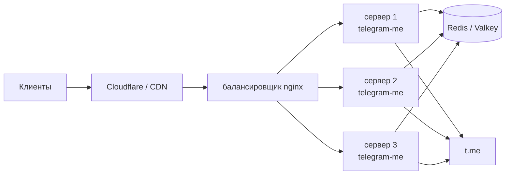
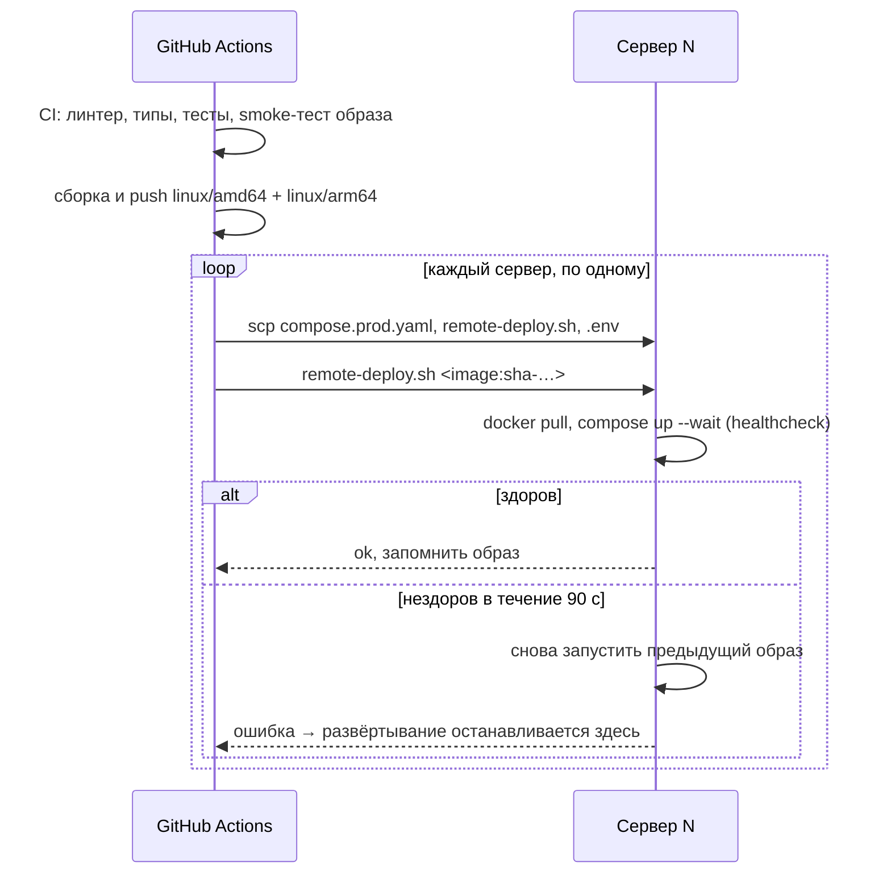

# Продакшен

Эталонная продакшен-конфигурация — несколько одинаковых серверов с общим Redis,
которые развёртывает GitHub Actions с поэтапным обновлением и автоматическим
откатом. Запросы попадают на серверы либо через ваш собственный балансировщик
нагрузки, либо напрямую из Cloudflare (проксируемые DNS-записи, по одной на
сервер), а TLS на каждом сервере завершает контейнер Caddy (см.
[Cloudflare без балансировщика](#cloudflare-without-a-load-balancer)).



## Подготовка сервера { #server-preparation }

Запустите
[`deploy/bootstrap-server.sh`](https://github.com/koval01/telegram-me/blob/main/deploy/bootstrap-server.sh)
один раз на каждом новом сервере Ubuntu от имени пользователя, под которым
входит GitHub Actions:

```bash
ssh ubuntu@<server> 'bash -s' < deploy/bootstrap-server.sh
```

Его можно безопасно запускать повторно. Скрипт:

- устанавливает Docker Engine и плагин compose из репозитория Docker;
- добавляет пользователя в группу `docker`;
- добавляет 2 ГиБ swap, если его нет (`SWAP_MB=0` пропускает этот шаг). Это
  помогает небольшим машинам вроде облачных инстансов с 1 ГБ памяти;
- открывает порт 443 в файрволе хоста на образах Oracle Cloud, которые
  блокируют всё, кроме SSH. Кто может подключаться, по-прежнему решает список
  безопасности или группа безопасности облака.

За собственным балансировщиком разрешите ему доступ к порту `8000`, а снаружи
не пускайте ничего больше, например с UFW:

```bash
sudo ufw default deny incoming
sudo ufw allow ssh
sudo ufw allow from 10.0.0.0/24 to any port 8000 proto tcp
sudo ufw enable
```

Больше ничего устанавливать не нужно: workflow при каждом развёртывании
копирует compose-файл, скрипт развёртывания и `.env`.

## Как проходит развёртывание { #how-a-deployment-works }



- Push в `main` запускает CI, собирает образ (теги `latest` и `sha-…`) и
  развёртывает `sha-…` на всех серверах из `SERVERS_IPS`, один за другим.
- [`deploy/remote-deploy.sh`](https://github.com/koval01/telegram-me/blob/main/deploy/remote-deploy.sh)
  ждёт, пока новый контейнер станет здоровым. Если этого не происходит, он
  перезапускает ранее развёрнутый образ (записанный в
  `~/telegram-me/.deployed-image`) и завершается ошибкой, что останавливает
  развёртывание — на оставшихся серверах остаётся старая версия.
- Первое развёртывание 2.0 заменяет контейнер 1.x (с именем `telegram-me`,
  запущенный через `docker run`). Если 2.0 не становится здоровым, контейнер
  1.x снова запускается из своего образа и `~/env.app`.
- Push тега `v2.0.0` дополнительно публикует теги `2.0.0`, `2.0`, `2` и релиз
  на GitHub с заметками из `CHANGELOG.md`.

## Конфигурация { #configuration }

### Секреты { #secrets }

| Секрет | Обязателен | Назначение |
|---|---|---|
| `SERVERS_IPS` | да | Адреса серверов через пробел, например `203.0.113.10 203.0.113.11`. Workflow маскирует каждый адрес в логах и называет серверы 1, 2, … |
| `SSH_KEY` | да | Приватный ключ для `SSH_USER` |
| `SSH_KNOWN_HOSTS` | рекомендуется | Вывод `ssh-keyscan` для серверов; без него ключам хостов доверяют при первом подключении (с предупреждением) |
| `REDIS_URL` | да | Общий Redis для всех серверов |
| `TLS_CERT`, `TLS_KEY` | с `PUBLIC_HOST` | Сертификат и ключ Cloudflare Origin CA (PEM) для Caddy; без них Caddy использует самоподписанный сертификат |
| `DOCKER_USERNAME`, `DOCKERHUB_TOKEN` | да | Push в Docker Hub (вместо токена принимается `DOCKER_PASSWORD`) |

### Переменные { #variables }

Переменные репозитория переопределяют продакшен-`.env`, который записывается
при каждом развёртывании:

| Переменная | По умолчанию | Примечания |
|---|---|---|
| `ENABLE_FEED` | `true` | В продакшене оставлено включённым ради существующих клиентов; в самом приложении по умолчанию `false` |
| `ENABLE_PREVIEWS` | `true` | |
| `ENABLE_RATE_LIMIT`, `RATE_LIMIT_RPM` | `false`, `120` | |
| `CACHE_MODE`, `PARSER_MODE` | `normal`, `full` | |
| `PUBLIC_HOST` | — | Публичное имя хоста, например `api.example.com`. Задайте его, чтобы запускать Caddy на порту 443 каждого сервера (Cloudflare без балансировщика) |
| `FORWARDED_ALLOW_IPS` | `127.0.0.1` | Укажите адрес(а) балансировщика. С `PUBLIC_HOST`: `172.29.53.0/24`, собственная сеть стека (Caddy) |
| `DISABLE_DOCS` | `false` | |
| `DEPLOY_IMAGE` | `docker.io/koval01/telegram-me` | Репозиторий, из которого идёт развёртывание |
| `SSH_USER` | `ubuntu` | |
| `PUBLIC_HEALTHCHECK_URL` | — | Проверяется после развёртывания, например `https://api.example.com/healthz` |

Используйте окружение `production` в настройках репозитория, чтобы добавить
обязательных ревьюеров или ограничить ветки, из которых можно развёртывать.

## Cloudflare без балансировщика { #cloudflare-without-a-load-balancer }

Когда проксируемые DNS-записи указывают на сами серверы, Cloudflare
подключается к порту 443 каждого из них. Задайте переменную `PUBLIC_HOST`, и
каждое развёртывание будет также запускать сервис `proxy` из
`compose.prod.yaml`: Caddy
([`deploy/Caddyfile`](https://github.com/koval01/telegram-me/blob/main/deploy/Caddyfile)).

- Caddy завершает TLS и проксирует запросы в API, который в этом случае
  слушает только `127.0.0.1:8000`.
- Адрес клиента берётся из `CF-Connecting-IP`, которому доверяют только из
  [диапазонов Cloudflare](https://www.cloudflare.com/ips/). Caddy передаёт его
  дальше в `X-Forwarded-For`, так что ограничение частоты запросов и логи
  видят настоящих клиентов.
- **Сертификат.** Создайте сертификат Origin CA в панели Cloudflare
  (*SSL/TLS → Origin Server*) и сохраните его в секретах `TLS_CERT` и
  `TLS_KEY`. Затем включите режим SSL **Full (strict)**. Без них Caddy отдаёт
  самоподписанный сертификат, который работает только в режиме SSL **Full**.
- В облачном файрволе (список или группа безопасности) пропускайте к порту
  443 только диапазоны Cloudflare, а к порту 8000 — никого.

Cloudflare выбирает одну из DNS-записей на каждое соединение. Пока сервер
перезапускается во время поэтапного развёртывания, часть запросов к нему может
несколько секунд завершаться ошибкой.

## Откат { #rolling-back }

Запустите workflow **Deploy** вручную (*Actions → Deploy → Run workflow*) с
тегом, на который нужно вернуться, например `sha-0123456789ab` (все сборки
хранятся в реестре). Используется та же поэтапная процедура.

На одном сервере можно откатиться и вручную:

```bash
cd ~/telegram-me
APP_IMAGE=docker.io/koval01/telegram-me:sha-0123456789ab \
  docker compose -f compose.prod.yaml up -d --wait
```

## Отдельный воркер ленты { #standalone-feed-worker }

Чтобы вынести рефрешер ленты из процессов API, запустите workflow Deploy с
отмеченным **with_worker**: тогда каждый сервер запускает сервис `worker`, а
API работает с `FEED_REFRESH_MODE=worker`. В любом случае выбор лидера в Redis
гарантирует единственный активный рефрешер на всех серверах.

## Эксплуатация { #operations }

```bash
cd ~/telegram-me
docker compose -f compose.prod.yaml ps
docker compose -f compose.prod.yaml logs -f --since 10m api
cat .deployed-image
```

В продакшене логи — это строки JSON (`LOG_FORMAT=json`) с ротацией по
5 × 50 МБ.
