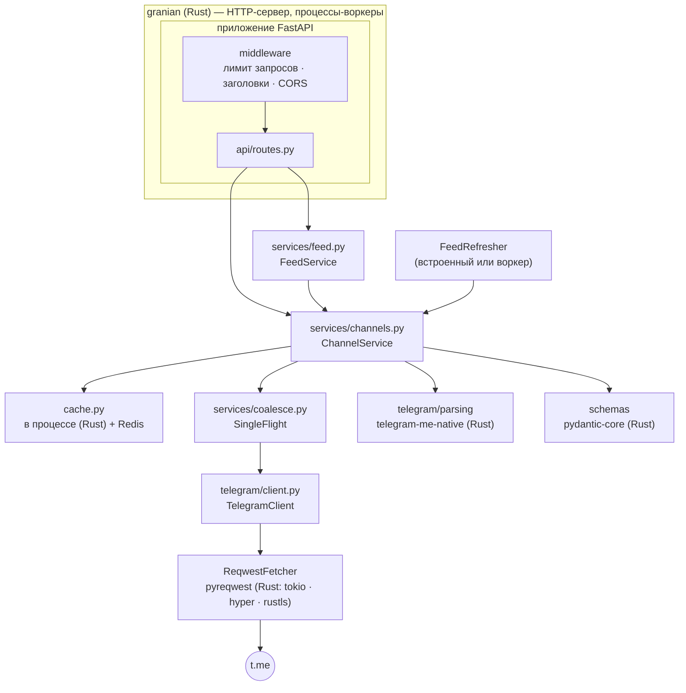

# Архитектура

TelegramMe — тонкий типизированный слой поверх публичных веб-превью t.me.
Бизнес-логика написана на Python; дорогие части — сетевой ввод-вывод, TLS,
HTTP/2, разбор HTML, JSON, HTTP-сервер — выполняются в нативном коде.

## Слои { #layers }

| Пакет | Ответственность |
|---|---|
| `api/` | Только HTTP: маршруты, валидация параметров, feature flags, сопоставление ошибок со статусами, чистый ASGI middleware |
| `services/` | Бизнес-логика: загрузка, кэширование и валидация страниц, лента, оценки, популярность, объединение запросов |
| `telegram/` | Всё, что относится к t.me: HTTP-клиент с правилами повторов и конкурентности, HTML-парсеры, типы ошибок |
| `schemas/` | Публичные модели ответов и запросов |
| `cache.py` | Уровни внутри процесса и в Redis с возрастом записей, circuit breaker |
| `container.py` | Создаёт и закрывает долгоживущие объекты; единственное место, которое знает, как всё связано |
| `app.py`, `server.py` | Фабрика приложения с lifespan; точки входа процессов |

Зависимости направлены только вниз: `api` → `services` → `telegram`,
`cache`. Ничто ниже `api` не импортирует FastAPI.

## Жизненный цикл запроса { #request-lifecycle }

На примере `GET /v1/body/durov`:

1. **granian** принимает соединение и передаёт запрос воркеру.
2. **Middleware**: ограничение частоты запросов (если включено), затем
   заголовки ответа (`X-App-Node`, `X-Process-Time`, `Cache-Control` для
   Cloudflare), затем CORS.
3. **FastAPI** проверяет `channel` по шаблону имени пользователя (→ `422`).
4. **`ChannelService.body_json`** ищет в кэше *готовый* отрендеренный ответ.
   Попадание возвращается как байты — без разбора и без валидации.
5. При промахе **SingleFlight** следит, чтобы `t.me/s/durov` загружала только
   одна корутина; конкурентные запросы ждут ту же задачу.
6. **`TelegramClient`** занимает слот семафора конкурентности процесса и
   запрашивает страницу у **`ReqwestFetcher`**; pyreqwest выполняет запрос по
   HTTP/2-соединению из пула в Rust, вне GIL, и возвращает декодированное
   тело. Оборвавшееся соединение повторяется один раз.
7. В одном из двух потоков разбора **`parse_channel_page`** передаёт HTML
   парсеру на Rust (с отпущенным GIL), который один раз строит дерево с
   html5ever и извлекает профиль канала, пагинацию и каждый пост; пост,
   который не удалось разобрать, пропускается и записывается в лог.
8. В том же потоке разобранная страница проверяется по `ChannelBody` (посты,
   не прошедшие валидацию, отбрасываются) и сериализуется pydantic-core; уже в
   event loop она кэшируется (для `/v1/post` и ленты) вместе с готовым
   ответом.
9. Маршрут возвращает байты JSON напрямую, минуя собственную валидацию ответов
   FastAPI.

## Lifespan { #lifespan }

`create_app()` создаёт приложение FastAPI; его lifespan открывает
[`Container`](https://github.com/koval01/telegram-me/blob/main/src/telegram_me/container.py)
(кэш, HTTP-клиент, сервисы) и, если лента включена в режиме `embedded`,
запускает задачу рефрешера. При остановке всё закрывается в обратном порядке:
рефрешер, HTTP-клиент, кэш.

## Модель процессов { #process-model }

`telegram-me serve` запускает granian с `WEB_CONCURRENCY` процессами-воркерами.
У каждого воркера свой цикл событий (uvloop), свой HTTP-клиент и свой кэш
внутри процесса (перед Redis, если он задан). granian перезапускает упавшие воркеры, может
перезапускать воркеры по памяти и передаёт `SIGTERM` для корректной
остановки.

`telegram-me worker` запускает только рефрешер ленты — для развёртываний,
которые выносят фоновую работу из процессов API.

## Нативные компоненты { #native-components }

| Задача | Библиотека | Реализовано на |
|---|---|---|
| HTTP-сервер, надзор за воркерами | granian | Rust |
| Цикл событий | uvloop | C (libuv) |
| Исходящий HTTP/2, TLS, пул соединений, распаковка | pyreqwest | Rust (tokio, hyper, rustls) |
| Разбор HTML и извлечение данных | `telegram-me-native` (html5ever, selectors, regex) | Rust |
| Валидация, JSON (ответы и кэш) | pydantic-core | Rust |
| Протокол Redis | hiredis | C |
| Ранжирование ленты, дубликаты, темы | `telegram-me-native` (этот проект) | Rust (PyO3) |
| Кэш внутри процесса | `telegram-me-native` (moka, libzstd) | Rust (PyO3), C |

Нативный код, написанный для этого проекта, находится в крейте Rust
[`rust/telegram-me-native`](https://github.com/koval01/telegram-me/tree/main/rust/telegram-me-native),
который собирается maturin как участник workspace uv. Python остаётся слоем
оркестрации: загрузка, кэширование, маршрутизация и склеивание результатов.

Измеренный эффект — на странице [Производительность](performance.md).
