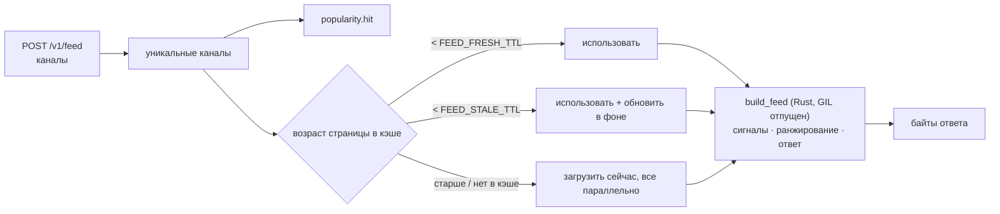

# Устройство ленты

## Как строится лента { #building-a-feed }



1. Каналы очищаются от дубликатов (с сохранением порядка) и учитываются в
   рейтинге популярности.
2. Все страницы загружаются конкурентно по правилам выше. Каждая страница
   используется в виде тех байтов, что лежат в кэше страниц; только что
   загруженная страница приходит вместе со своим представлением для кэша, так
   что в Python ничего не декодируется и не кодируется.
3. `telegram_me_native.build_feed()` — Rust,
   [`rust/telegram-me-native/src/feed.rs`](https://github.com/koval01/telegram-me/blob/main/rust/telegram-me-native/src/feed.rs) —
   выполняется в рабочем потоке с отпущенным GIL и делает остальное за один
   вызов:
    - читает каждую страницу за один проход, сохраняя каждый пост в виде того
      JSON-текста, в котором он был закэширован, и отбрасывает пост, уже
      встреченный под тем же username;
    - извлекает сигналы ранжирования из footer и content каждого поста:
      разобранный счётчик просмотров (`1.2K`, `15 400`), число подписчиков
      канала, суммы положительных и отрицательных реакций, количество медиа,
      простой текст, время публикации, признак редактирования;
    - ранжирует их ([`rank.rs`](https://github.com/koval01/telegram-me/blob/main/rust/telegram-me-native/src/rank.rs), см. ниже);
    - пишет ответ: каждый пост со своим `channel`, `_score` и, когда они есть,
      `_duplicates` и `_topic`.

    Страница, которая не является корректным JSON (повреждённая запись кэша),
    пропускается и попадает в лог. Поле `feed` в GraphQL декодирует те же байты.

## Ранжирование { #ranking }

Всё, что описано ниже, происходит в Rust.

### Текст { #text }

Тексты разбиваются на слова из букв и цифр в нижнем регистре; URL, упоминания,
числа, короткие слова и стоп-слова русского, украинского и английского
языков отбрасываются. Слова приводятся к основе: отбрасывается типичное
кириллическое окончание и сохраняются первые пять символов («ракеты»,
«ракетой» → «ракет»), что сопоставляет словоформы без какой-либо языковой
модели.

### Качество { #quality }

| Сигнал | Как считается |
|---|---|
| **Вовлечённость** (вес 0.45) | Просмотры экстраполируются до итогового значения по возрасту поста (`views / (1 − e^(−age/24h))`) и сравниваются в логарифмической шкале с другими постами канала в пакете: робастный z-score по медиане и медианному абсолютному отклонению, сжатый сигмоидой. Пост, который *для своего канала* показывает себя необычно хорошо, получает высокую оценку независимо от размера канала. Каналы, у которых в пакете меньше трёх постов, сравниваются со всеми постами по просмотрам на подписчика. |
| **Реакции** (0.20) | Чистые положительные реакции на просмотр (Telegram Stars считаются положительными), с насыщением на 2 %. |
| **Контент** (0.15) | Медиа (`photos + 2·videos + gifs + 2·polls`, в логарифмической шкале) и длина текста. |
| **Аудитория** (0.10) | Логарифм числа подписчиков относительно самого крупного канала в пакете. |
| **Тональность** (0.10) | Единица минус доля отрицательных реакций. |
| **Отредактирован** (+0.02) | Небольшой бонус. |

### Свежесть { #freshness }

```text
freshness = 0.5 ^ (age_hours / FEED_HALF_LIFE_HOURS)          (default 24 h)
score     = 10 · quality · (0.1 + 0.9 · freshness)             ∈ [0, 10]
```

### Дубликаты { #duplicates }

Одну и ту же новость часто публикуют несколько каналов, иногда с добавленным
заголовком или подписью. Каждый текст длиной не меньше десяти слов получает
64-битный SimHash его трёхсловных шинглов и множество этих шинглов. Два поста
считаются дубликатами, если их значения SimHash различаются не более чем в 20
битах (дешёвый предварительный фильтр) **и** не меньше 70 % шинглов более
короткого текста встречаются в другом (вложенность). Дубликаты группируются
транзитивно (union-find); пост с лучшей оценкой в каждой группе остаётся в
ленте и перечисляет остальные в `_duplicates`. Отключается через
[`FEED_COLLAPSE_DUPLICATES=false`](../configuration.md#feed_collapse_duplicates).

### Разнообразие { #diversity }

Посты расставляются жадно. Скорректированная оценка кандидата равна

```text
score · (1 − d · max cosine similarity to the last 10 placed posts)
      · (1 − d/2) ^ (posts of the same channel among the last 5 placed)
```

где `d` = [`FEED_DIVERSITY`](../configuration.md#feed_diversity) (по
умолчанию 0.5; 0 даёт простой порядок по оценке). Сходство — это косинус
TF-IDF-векторов. Поскольку штрафы никогда не повышают оценку, кандидаты
перебираются в порядке базовой оценки, и перебор останавливается, как только
ни одна оставшаяся базовая оценка не может превзойти лучшую
скорректированную, так что результат точен без сравнения всех пар на каждом
шаге.

Свежесть по-прежнему доминирует: канал, опубликовавший пост несколько часов
назад, займёт большую часть верха ленты, остальные каналы которой
публиковались недели назад, — разнообразие распределяет посты сопоставимой
ценности, но не продвигает устаревшие.

### Темы { #topics }

Telegram не раскрывает категории каналов, поэтому темы выводятся из текстов:
TF-IDF-векторы по пакету (сглаженный IDF) жадно кластеризуются в порядке
ленты — пост присоединяется к самой похожей теме, если косинусное сходство с
её центроидом не меньше 0.3, иначе начинает новую. Темы как минимум из двух
постов указываются у своих постов как `_topic: {"id": …, "keywords": […]}`;
ключевые слова — самые весомые термины центроида в их наиболее частой
написанной форме.

### Производительность { #performance }

Токенизация и поиск дубликатов выполняются параллельно на всех ядрах (rayon);
хеш-таблицы используют FxHash. Измерено через
`cargo run --release --example bench` (Apple Silicon, тексты по 30 слов):

| Постов | Время ранжирования |
|---|---|
| 120 (лента из 6 каналов) | ~1 мс |
| 500 | ~4 мс |
| 2 000 (100 каналов) | 17–24 мс |

Ранжирование выполняется в рабочем потоке с отпущенным GIL, поэтому цикл
событий тем временем продолжает обслуживать другие запросы.

## Популярность и рефрешер { #popularity-and-the-refresher }

Каждый запрос ленты добавляет 1 к оценке каждого канала из него. Оценки
экспоненциально затухают с `FEED_POPULARITY_HALF_LIFE` (1 час): каждую минуту
рефрешер умножает все оценки на `0.5^(elapsed / half-life)` и забывает каналы
с оценкой ниже 0.05. С Redis рейтинг — это отсортированное множество, общее
для всех экземпляров (`ZINCRBY`, `ZUNIONSTORE … WEIGHTS`).

Каждые 5 секунд рефрешер:

1. захватывает или продлевает лидерство (`SET … NX PX 30000` со случайным
   токеном, продление — Lua-скриптом, который проверяет токен); дальше
   продолжает только лидер;
2. читает `FEED_REFRESH_TOP` самых популярных каналов;
3. обновляет каждый канал, последнее обновление которого старше

    ```text
    interval(score) = clamp(FEED_REFRESH_MAX_INTERVAL / (1 + score),
                            FEED_REFRESH_MIN_INTERVAL, FEED_REFRESH_MAX_INTERVAL)
    ```

    Так канал, который запрашивают ~20 раз за период полураспада,
    обновляется каждые 30 с, а канал, запрошенный один раз, — каждые
    10 минут.

Лидерство переходит автоматически, когда лидер останавливается (он
освобождает блокировку) или умирает (блокировка истекает в течение 30 с). Без
Redis каждый процесс сам себе лидер для собственного кэша в памяти.

Обновлённые страницы попадают в общий кэш страниц, поэтому следующий запрос
ленты — на любом сервере — находит их свежими.
